# Hi, I'm Fabian

**Frontend developer in training** at the [Developer Akademie](https://developerakademie.com), based in Villach, Austria.
I build responsive, accessible websites with HTML, CSS and vanilla JavaScript, and I'm looking for my first remote role.

<!-- LinkedIn: replace YOUR-PROFILE and remove the comment tags

-->

---

## About me

- I work as an EMT (Rettungssanitäter) in a hospital. That job taught me to stay calm under pressure, communicate clearly and work in a team where details matter.
- Since 2026 I'm retraining as a software developer at the Developer Akademie.
- I care about code other people can read: small functions, semantic HTML and accessibility from the first line, not as an afterthought.
- Goal: a remote frontend role in a team I believe in.

---

## Featured projects

| Project | What it is | Built with | Demo |
|-|-|-|-|
| [**Pokedex**](https://github.com/Klmnz96/Pokedex) | Pokedex app that loads Pokemon data live from the PokeAPI. | JavaScript, REST API | [Live](https://klmnz96.github.io/Pokedex/) |
| [**Food Order App**](https://github.com/Klmnz96/Bestell-App) | Food delivery app with menu categories, a shopping cart with quantity controls, live price totals and an order flow. | HTML, CSS, JavaScript | [Live](https://klmnz96.github.io/Bestell-App/) |
| [**Nissan Skyline GT-R**](https://github.com/Klmnz96/Nissan-Skyline-Landingpage) | Premium landing page with an interactive 3D car model and scroll animations. | HTML, CSS, JavaScript | [Live](https://klmnz96.github.io/Nissan-Skyline-Landingpage/) |
| [**Aurum**](https://github.com/Klmnz96/Aurum) | Website for a fictional luxury watch brand with a working shopping cart. | fetch, localStorage | [Live](https://klmnz96.github.io/Aurum/) |
| [**Weather App**](https://github.com/Klmnz96/Weather-App) | Live weather data from the Open-Meteo API with a saved light/dark mode. | REST API, localStorage | [Live](https://klmnz96.github.io/Weather-App/) |
| [**Studio Kalk**](https://github.com/Klmnz96/Studio-Kalk) | Website for a fictional architecture studio, content loaded from JSON. | fetch, JSON | [Live](https://klmnz96.github.io/Studio-Kalk/) |
| [**Gambit**](https://github.com/Klmnz96/Gambit) *(in progress)* | Browser chess with a built-in trainer that teaches beginners while they play. Two players on one device or against the computer. | HTML, CSS, JavaScript | Coming soon |

More in my [repositories](https://github.com/Klmnz96?tab=repositories).

---

## How I work

- **Mobile first:** every layout is tested down to 320px.
- **Accessible:** semantic HTML, aria-labels on buttons and dialogs, readable contrast, no text below 16px.
- **Clean JavaScript:** short functions with one job, templates without logic, API calls in their own file.
- **Design first:** I plan layouts in Figma before I write code.

---

## Tech stack

**Daily use**

**Up next**

---

<picture>
  <source media="(prefers-color-scheme: dark)" srcset="https://raw.githubusercontent.com/Klmnz96/Klmnz96/pacman-output/pacman-contribution-graph-dark.svg">
  <source media="(prefers-color-scheme: light)" srcset="https://raw.githubusercontent.com/Klmnz96/Klmnz96/pacman-output/pacman-contribution-graph.svg">
  
</picture>
