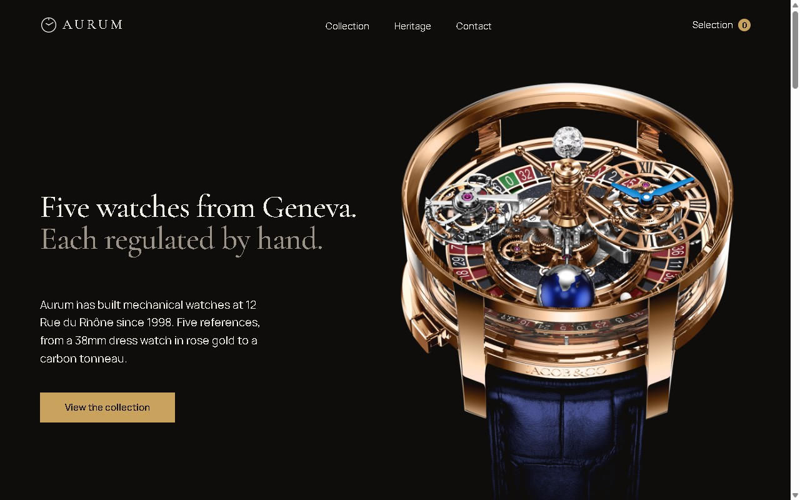
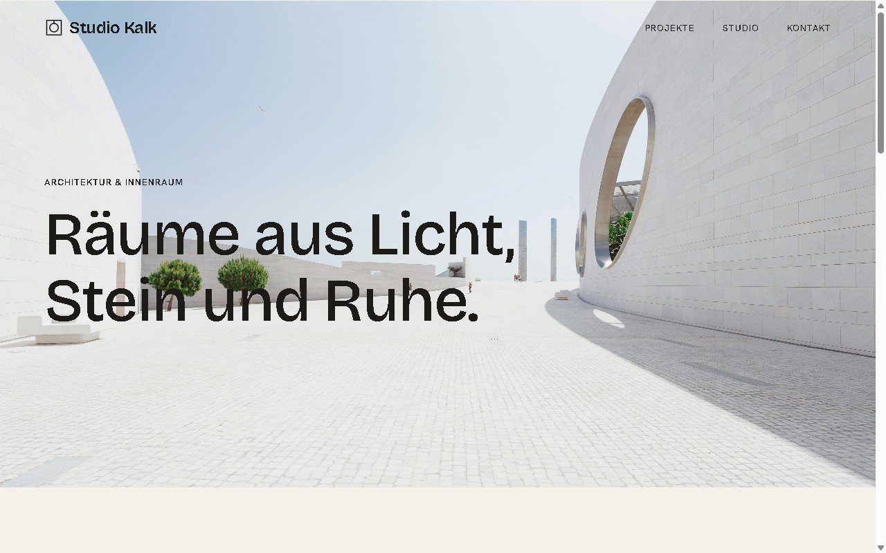
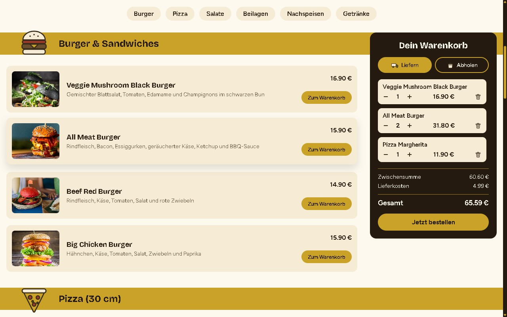
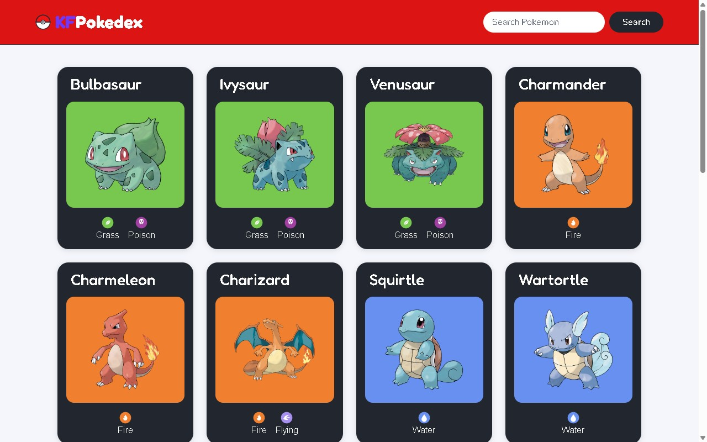
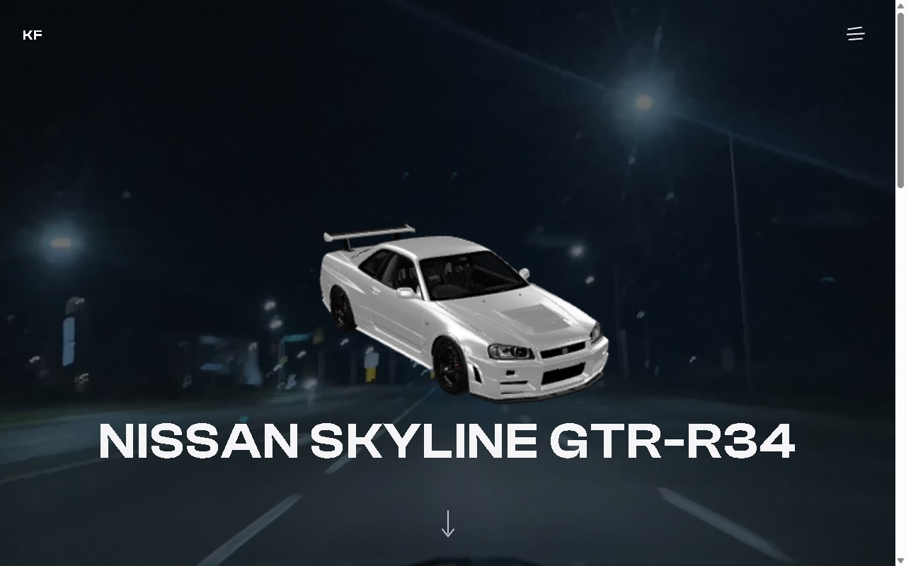
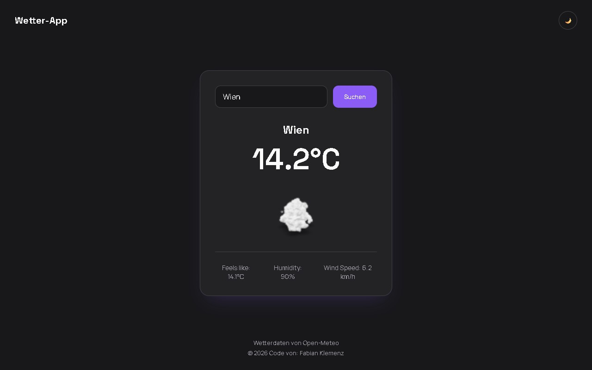
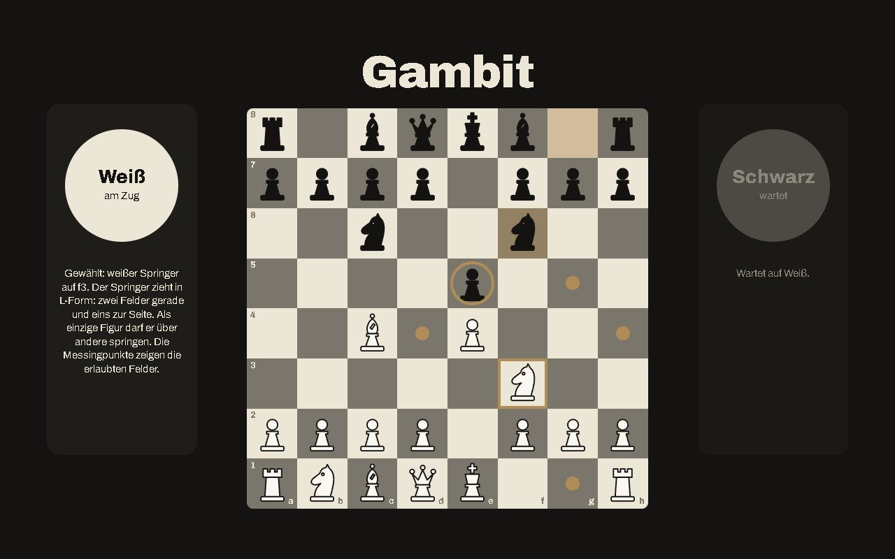

<picture>
  <source media="(prefers-color-scheme: dark)" srcset="assets/banner-dark.svg">
  
</picture>

I work as an EMT (Rettungssanitäter) in a hospital in Carinthia and I'm retraining as a full stack developer at the [Developer Akademie](https://developerakademie.com). Right now I'm in the frontend part, building responsive, accessible websites with HTML, CSS and vanilla JavaScript. The backend part comes next. I'm looking for my first remote role.

Twelve-hour hospital shifts taught me to stay calm under pressure, explain things clearly and double-check the details. I bring the same habits to code.

## Projects

Every screenshot opens the live site.

<table>
  <tr>
    <td width="50%" valign="top">
      
      
<b>Aurum</b> Website for a fictional luxury watch brand with a working shopping cart.

      
<a href="https://klmnz96.github.io/Aurum/">Live demo</a> &nbsp;|&nbsp; <a href="https://github.com/Klmnz96/Aurum">Code</a> HTML, CSS, JavaScript, fetch, localStorage

    </td>
    <td width="50%" valign="top">
      
      
<b>Studio Kalk</b> Website for a fictional architecture studio, content loaded from JSON.

      
<a href="https://klmnz96.github.io/Studio-Kalk/">Live demo</a> &nbsp;|&nbsp; <a href="https://github.com/Klmnz96/Studio-Kalk">Code</a> HTML, CSS, JavaScript, fetch, JSON

    </td>
  </tr>
  <tr>
    <td width="50%" valign="top">
      
      
<b>Food Order App</b> Delivery app with menu categories, a cart with quantity controls, live totals and an order flow.

      
<a href="https://klmnz96.github.io/Bestell-App/">Live demo</a> &nbsp;|&nbsp; <a href="https://github.com/Klmnz96/Bestell-App">Code</a> HTML, CSS, JavaScript

    </td>
    <td width="50%" valign="top">
      
      
<b>Pokedex</b> Pokedex app that loads Pokemon data live from the PokeAPI.

      
<a href="https://klmnz96.github.io/Pokedex/">Live demo</a> &nbsp;|&nbsp; <a href="https://github.com/Klmnz96/Pokedex">Code</a> JavaScript, REST API

    </td>
  </tr>
  <tr>
    <td width="50%" valign="top">
      
      
<b>Nissan Skyline GT-R</b> Premium landing page with an interactive 3D car model and scroll animations.

      
<a href="https://klmnz96.github.io/Nissan-Skyline-Landingpage/">Live demo</a> &nbsp;|&nbsp; <a href="https://github.com/Klmnz96/Nissan-Skyline-Landingpage">Code</a> HTML, CSS, JavaScript, 3D

    </td>
    <td width="50%" valign="top">
      
      
<b>Weather App</b> Live weather data from the Open-Meteo API with 3D weather models and a saved light/dark mode.

      
<a href="https://klmnz96.github.io/Weather-App/">Live demo</a> &nbsp;|&nbsp; <a href="https://github.com/Klmnz96/Weather-App">Code</a> JavaScript, REST API, localStorage

    </td>
  </tr>
  <tr>
    <td width="50%" valign="top">
      
    </td>
    <td width="50%" valign="top">
      
<b>Gambit</b> &nbsp;in progress Browser chess with a built-in trainer that teaches beginners while they play. Select a piece and the trainer explains how it moves and marks every legal square. Two players on one device or against the computer.

      
<a href="https://github.com/Klmnz96/Gambit">Code</a> &nbsp;|&nbsp; Live demo coming soon HTML, CSS, JavaScript

    </td>
  </tr>
</table>

## How I work

- **Mobile first:** every layout is tested down to 320px.
- **Accessible:** semantic HTML, aria-labels on buttons and dialogs, readable contrast, no text below 16px.
- **Clean JavaScript:** short functions with one job, templates without logic, API calls in their own file.
- **Design first:** I plan layouts in Figma before I write code.

## Tech stack

### Daily use

### Up next

Angular for the frontend, then Python and Node.js in the backend part of my training.

<picture>
  <source media="(prefers-color-scheme: dark)" srcset="https://raw.githubusercontent.com/Klmnz96/Klmnz96/pacman-output/pacman-contribution-graph-dark.svg">
  <source media="(prefers-color-scheme: light)" srcset="https://raw.githubusercontent.com/Klmnz96/Klmnz96/pacman-output/pacman-contribution-graph.svg">
  
</picture>
